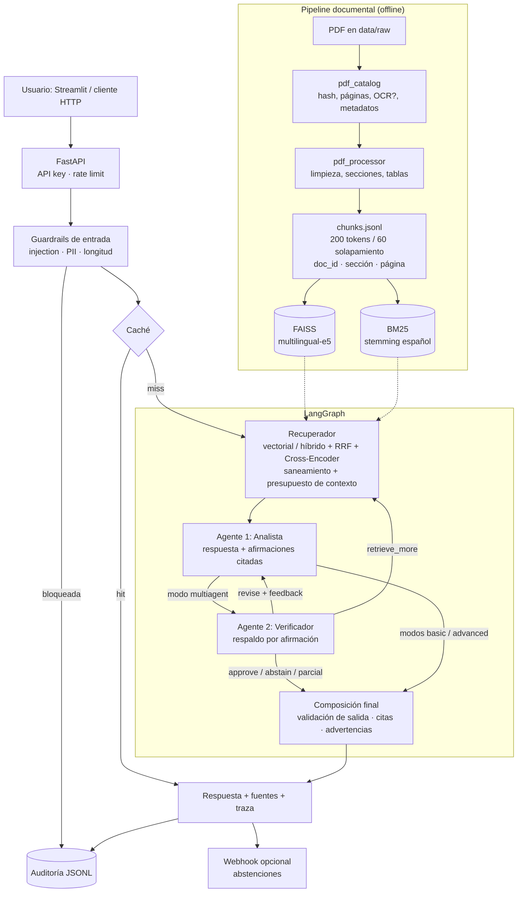

# Arquitectura de HealthRAG

## Flujo de datos

## Componentes

| Componente | Módulo | Descripción |
|---|---|---|
| Catálogo | `app/ingestion/pdf_catalog.py` | Hash SHA-256, páginas, texto extraíble, detección de escaneados, duplicados y `doc_id` faltantes/repetidos. |
| Procesamiento | `app/ingestion/pdf_processor.py` | PyMuPDF por página; elimina encabezados/pies repetidos y números de página; une líneas y guiones; secciones desde el TOC + tipografía; tablas como filas indivisibles; chunks por oraciones sin cruzar páginas. |
| Embeddings | `app/retrieval/embedder.py` | Sentence Transformers (`multilingual-e5-small`, prefijos `query:`/`passage:`), normalizados L2. |
| Índices | `app/retrieval/indexes.py` | FAISS `IndexFlatIP` (coseno) persistido con manifiesto; BM25 Okapi con análisis en español. |
| Fusión | `app/retrieval/fusion.py` | Reciprocal Rank Fusion (k=60). |
| Reranking | `app/retrieval/reranker.py` | Cross-Encoder multilingüe mMARCO. |
| Analista | `app/agents/analyst.py` | Sintetiza y devuelve JSON con afirmaciones atómicas citadas; reintento ante JSON inválido; incorpora el feedback del verificador. |
| Verificador | `app/agents/verifier.py` | Evalúa cada afirmación (sí/parcial/no, cita correcta); política determinística: aprobar, revisar, re-recuperar, abstenerse o entregar solo lo respaldado. |
| Orquestación | `app/agents/graph.py` | `StateGraph` de LangGraph con canales acumulativos de traza, uso de tokens y tiempos. |
| Servicio | `app/rag/pipeline.py` | Punto de entrada único: guardrails, caché, grafo, costo, auditoría, acción final. |
| Seguridad | `app/security/` | Guardrails de entrada/salida, saneamiento de evidencia, API keys con roles, rate limit, auditoría. |
| API / UI | `app/api/`, `frontend/` | FastAPI (`/query`, `/health`, `/sources`, `/audit`) y demo Streamlit. |
| Evaluación | `app/evaluation/` | Hit, Recall, Precision y nDCG sobre los primeros k resultados, MRR, contexto útil; fidelidad, precisión de citas, abstención, ROUGE-L, BLEU, similitud semántica; latencia p50/p95, tokens, costo; iteraciones, veredictos y redundancia. |

## Correspondencia con las consignas del TP

| Consigna | Implementación |
|---|---|
| API funcional | FastAPI + Streamlit |
| ≥ 2 agentes con comunicación dinámica | Analista y Verificador con mensajes estructurados, retroalimentación (revise) y re-recuperación (retrieve_more) |
| RAG retriever-ranker, trazabilidad | BM25 + embeddings + RRF + Cross-Encoder; cita con documento, sección y página |
| Seguridad | API keys con roles, filtros de entrada, validación de salida, auditoría JSONL |
| Flujo modular y monitoreable | Componentes desacoplados, logging por módulo, traza y tiempos por nodo |
| Optimización de costo/latencia | Caché TTL, presupuesto de tokens de contexto, `max_tokens`/temperatura 0, verificador con modelo configurable, embeddings precomputados |
| Acción automática (opcional) | Webhook ante abstención o afirmaciones descartadas + log de auditoría |
| Métricas | `app/evaluation/metrics.py` y `run_experiments.py` (EXP1-EXP4) |
